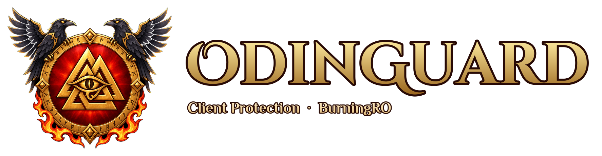
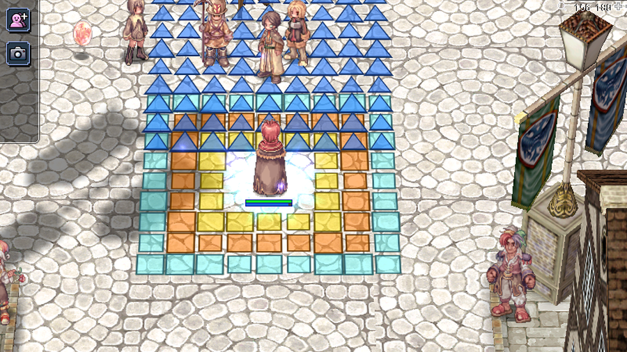
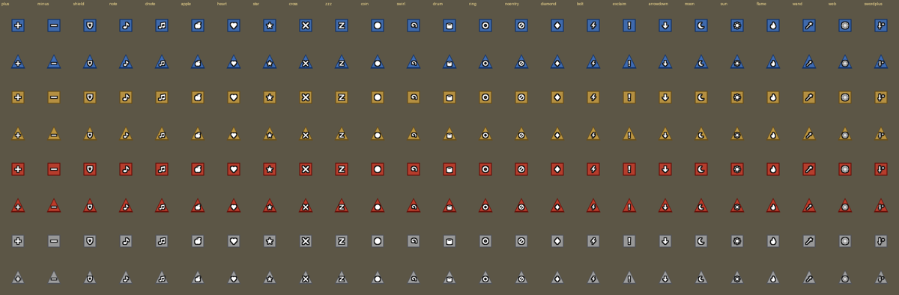
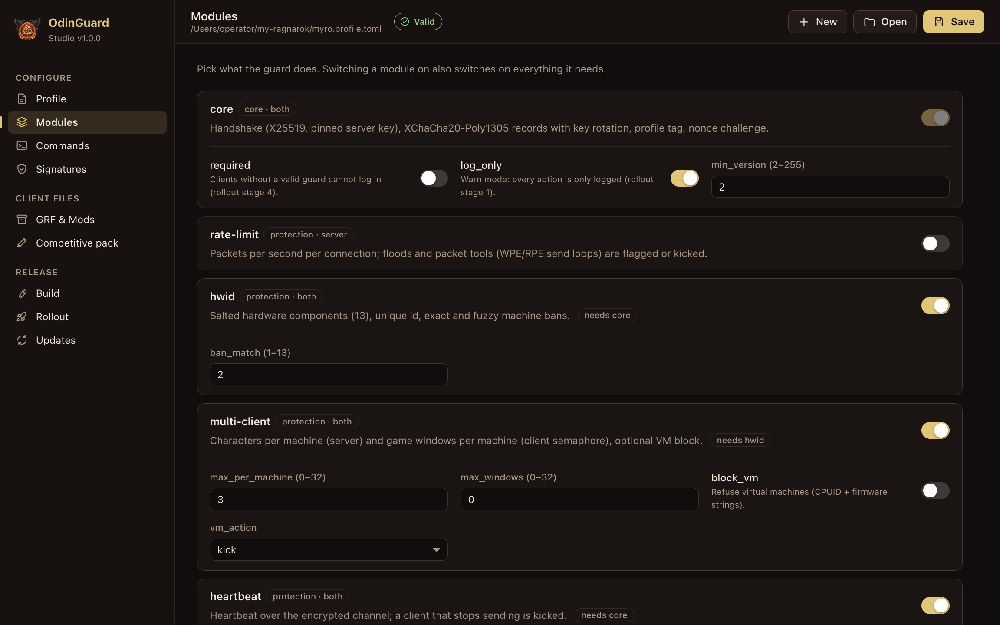
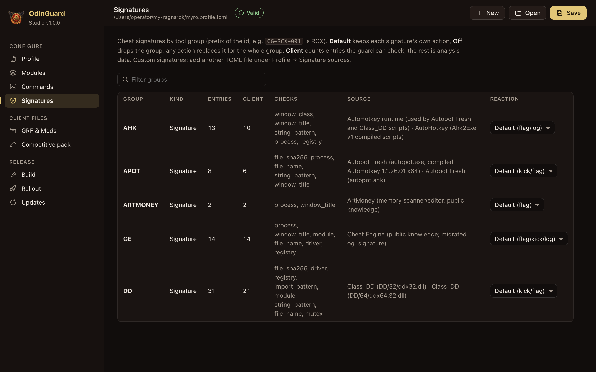

# OdinGuard Anti Cheat

<p align="center">
  
</p>

<p align="center">
  <a href="https://github.com/sponsors/kxdrsrt"></a>
  <a href="https://ko-fi.com/kadirsert"></a>
  <a href="https://opencollective.com/kxdrsrt"></a>
  <a href="https://www.patreon.com/cw/kxdrsrt"></a>
  <a href="https://liberapay.com/kxdrsrt/"></a>
</p>

> **Vorerst nur Pre-Renewal.** OdinGuard wurde für **Pre-Renewal-Server** gebaut und getestet (rAthena `pre-re`,
> PACKETVER 20180620, Client 2018-06-20). Die Lite Ground Skills (LGP) und die Map-Listen des Competitive-Packs gibt es
> nur für Pre-Renewal. Alle anderen Funktionen (Handshake, Integrität, Signaturen, Server-Regeln, Bans, Challenges,
> GRF-Check, Studio) hängen nicht am Renewal-Schalter und sollten auch mit Renewal laufen, sind dort aber nicht getestet.

**OdinGuard und Studio gehören zusammen:** Das Studio baut das signierte Release des Guards für das eigene Profil,
deshalb werden beide gemeinsam versioniert und veröffentlicht (ein Tag, ein Release).

<p align="center">
  
  &nbsp;
  
</p>

<p align="center">
  
  &nbsp;
  
</p>

English: [README.md](README.md) · Einbau-Anleitung: [docs/INTEGRATION.md](docs/INTEGRATION.md)

Universelles, modulares Anti-Cheat-Toolkit für Ragnarok-Online-Server auf rAthena-Basis (getestet mit xAthena,
Client 2018-06-20). Betreiber konfigurieren es im **OdinGuard Studio** (oder headless mit `og`) und bauen daraus
ein signiertes Release für Client und Server. Version 1.0.2.

- Client: 32-Bit-Windows-DLL `odinguard.dll` + Loader `ijl15.dll` (Proxy, kein Exe-Patch), C11.
- Server: Modul für rAthena/xAthena (`src/common/odinguard.*`, `src/login/og_login.*`, `src/map/og_map*.cpp`), C++.
- Studio: Rust-Workspace (`studio/`) mit `og-core`, `og-cli`, `og-mcp` (MCP-Server mit 18 Tools: Profil, Module, Validierung, GRF-Scan und Release-Build per KI-Assistent) und Tauri-2-GUI.

## Schnellstart (Betreiber)

```
brew install mingw-w64                       # Cross-Compiler für die Client-DLL
cd studio && cargo build --release           # og-cli -> studio/target/release/og
og new meinserver.profile.toml --id meinserver --operator "Mein RO"   # Profil + Schlüssel (nie committen)
og validate meinserver.profile.toml
og build meinserver.profile.toml             # Release -> output aus dem Profil
og verify-release <release-ordner>
```

GUI: `cd studio/apps/studio && npm install && npx tauri dev` (Profil öffnen, Module/Challenges/Commands/Signaturen/GRF-Regeln
wählen, bauen, Rollout-Stufe prüfen). Das Release enthält ein Betreiber-Handbuch (`docs/handbook.md`).

## LGP auf einen Blick

*Lite Ground Skills* ersetzen die unruhigen Bodeneffekte (Storm Gust, Pneuma, Safety Wall, Songs, Fallen ...) durch
flache, farbige Kacheln: **Quadrat = schützend, Dreieck = schädlich**, ein kleines Symbol zeigt die Art (`+` Buff-Feld,
`−` Debuff-Zone, Schild, Note ...). Alles ist Spielerwahl:

| Befehl | Wirkung |
|---|---|
| `@lgp` | Hauptschalter an/aus. Jeder Skill behält *seine* Farbe. |
| `@square 2-18` | Farbset: eine Farbe für alle Skills (`@square 1` = Farbe je Skill, `@square off` = aus). |
| `@aoes` | Kacheln nur für Storm Gust, Lord of Vermilion, Meteor Storm; alle anderen Skills zeigen ihren normalen Effekt. |
| `@circle 1-5` | Ringe um den eigenen Charakter. |
| `@lgpsound` | Skill-Sounds bei Kacheln behalten oder stumm. |
| `!dark [on\|off]` | Competitive-Pack (flache Maps, dunkler Boden) an/aus; Neustart nötig. |
| `@pf on\|off\|c i g` | Paketfilter auf WoE-/BG-Maps: kein Chat (c), keine Item-Nutzung (i), keine Emotes (g) anderer Spieler. |
| `@spb` | Support-Buffs aller Party-Mitglieder mit Restzeit (im Chat). |

Vollständiger Leitfaden mit allen Optionen, Flags und `!`-Befehlen: [docs/08-lgp-guide.md](docs/08-lgp-guide.md).
Vorerst nur Pre-Renewal; der Rest von OdinGuard läuft auch mit Renewal-Clients.

## Inhalt

| Pfad | Inhalt |
|---|---|
| `modules/` | Registry: `modules.toml` (23 Module), `commands.toml` (19 Commands) |
| `profiles/` | `default` (Funktionsumfang v0.3), `minimal` (core + rate-limit), `e2e` (Testprofil) |
| `signatures/` | Cheat-Signaturen und Allowlist (Quelle für das signierte Signaturpaket) |
| `assets/odin-grf/` | Eigene Assets für `odin.grf` (LGP-Kacheln) |
| `proto/` | Protokoll v2 (`og_proto.h`) und gemeinsame Parser (`og_wire.c`, byte-identisch im Server) |
| `client/` | Guard (`src/`), Loader, Ressourcen, Spieler-README (`package/`), Tests (`tests/`) |
| `server/` | Release-Kopie des xAthena-Moduls (`tools/sync_server.sh`), `HOOKS.txt`, SQL |
| `studio/` | `og-core`, `og-cli`, `og-mcp` (MCP-Server), `apps/studio` (Tauri 2) |
| `tests/e2e/` | End-to-End-Suite (Docker-Server + Windows-VM) |
| `analysis/` | Cheat-Analyse (nur Signaturdaten, keine Binaries), Ghidra-Ergebnisse |
| `tools/` | `release_studio.sh`, `sync_server.sh`, `og_keygen.c`, `make_branding.py`, `pack/`, `ghidra/`, `dev/` |
| `third_party/` | Monocypher (CC0/BSD-2), MinHook (BSD-2) |

## Dokumentation

- `docs/02-architecture.md` – Modulsystem, Profil, Protokoll, Challenges, Detection, Registry, Studio, Updater,
  Härtung (Hürde vs. echte Sicherheit), Sprach-ADR
- `docs/03-integration.md` – Einbindung beim Betreiber und Rollout-Stufen
- `docs/05-tests.md` – Testmatrix und Live-Abnahme-Checkliste
- `docs/06-gepard-comparison.md` – Vergleich mit Gepard Shield
- `docs/07-darkworld-lgp.md` – darkworld-Analyse, LGP-Kacheln, Competitive-Pack (Fairness-Befunde)
- `docs/08-lgp-guide.md` – LGP-Anleitung (Befehle, Flags, Konfiguration; Englisch)
- `docs/09-competitive-pack.md` – Competitive-Pack je Modus, Pflicht auf Maps, Map-Cache-Prüfung (Englisch)
- `docs/10-mcp.md` – MCP-Server `og-mcp`: Profile konfigurieren und Releases bauen per KI-Assistent (Englisch)
- `docs/01`, `docs/04` – Referenzanalyse und Reverse Engineering des eigenen Clients
- `analysis/cheat-signatures/` – Inventar, Signaturen, Allowlist, Verhaltenssignaturen

## Tests

```
make -C client                 # DLLs, selftest, nettest, dettest
make -C client fuzz            # Parser-Fuzzing (ASan/UBSan)
cd studio && cargo test --workspace && cargo clippy --workspace --all-targets
sh tests/e2e/run.sh <xathena-build> dist/e2e dist/minimal
```

## Sicherheit

Schlüssel (`keys/`, `profiles/keys/`, `secrets/` im Release, `keys/studio-updater.key`) sind git-ignoriert und
werden nie committet. Client-Prüfungen sind Hürden; echte Sicherheit kommt aus den serverseitigen Regeln
(siehe `docs/02-architecture.md` Abschnitt 11).
