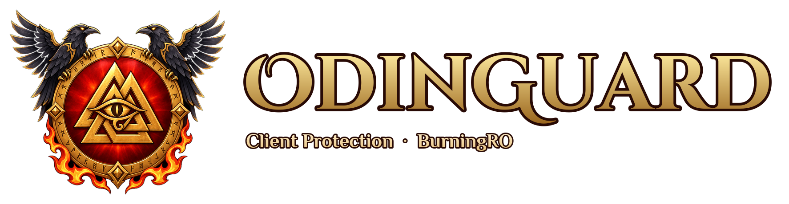
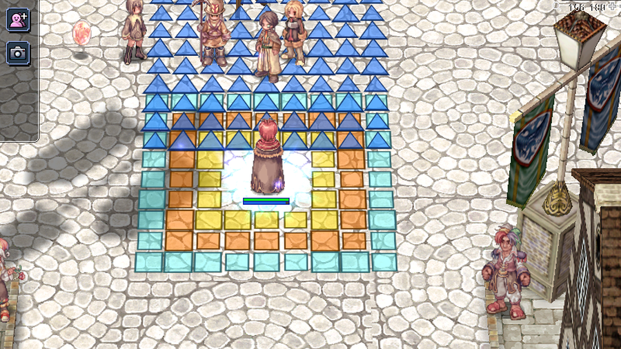
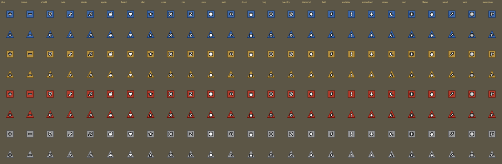

# OdinGuard Anti Cheat

<p align="center">
  
</p>

> _Open-source, modular anti-cheat for Ragnarok Online servers, with its own Studio to configure and build it._

**Windows client (C11) · rAthena module (C++) · OdinGuard Studio (Rust + Tauri 2)** · **MIT or Apache-2.0** · **v1.0.0**

<p align="center">
  <a href="#licence"></a>
  
</p>

<p align="center">
  <a href="https://github.com/sponsors/kxdrsrt"></a>
  <a href="https://ko-fi.com/kadirsert"></a>
  <a href="https://opencollective.com/kxdrsrt"></a>
  <a href="https://www.patreon.com/cw/kxdrsrt"></a>
  <a href="https://liberapay.com/kxdrsrt/"></a>
</p>

> **Pre-renewal first.** OdinGuard was built and tested for **pre-renewal** servers (rAthena `pre-re`, PACKETVER
> 20180620, client 2018-06-20). The lite ground skills (LGP) and the competitive-pack map lists are pre-renewal only.
> Every other feature (handshake, integrity, signatures, server rules, bans, challenges, GRF check, Studio) does not
> depend on the renewal switch and is expected to work on renewal servers too, but has not been tested there.

**OdinGuard and its Studio belong together:** the Studio builds the signed release of the guard for *your* profile, so
they are versioned and released together (one tag, one release, both tools).

Deutsch: [README.de.md](README.de.md)

---

<p align="center">
  
  &nbsp;
  
</p>

---

Open-source, modular anti-cheat for Ragnarok Online servers running **rAthena** (or a fork). Server owners pick
the protection modules, challenges, commands and signatures in **OdinGuard Studio** and get a signed,
reproducible release for client and server – their own keys, their own build.

## Why

Ragnarok Online servers fight packet editors, bots, macro and autopot tools, memory readers, no-delay GRFs and
modified clients. Closed anti-cheats are hard to audit, cause start-up hangs and false "illegal files" alarms, and
tie every server to one vendor. OdinGuard is:

- **Server-authoritative.** The server decides. Client checks raise the cost of cheating and produce evidence; the
  real security comes from server-side rules (rate limits, delay checks, honeypots, captchas, mandatory handshake).
- **Open code, secret keys.** Security comes from per-server keys and per-server build variation, not from hiding
  the code.
- **Modular.** Unselected modules are not compiled into the client DLL (checked against the linker map).
- **Careful with players.** Every rule has severity, confidence and an action (log, flag, flag-then-ban, kick,
  ban); bans come in delayed waves; rollout starts in warn mode; legitimate add-ons are allowlisted.

## Features

| Area | |
|---|---|
| Network | X25519 handshake with a pinned server key, XChaCha20-Poly1305 for the whole game stream, replay protection, key rotation, per-server profile tag, downgrade protection, fuzzed parsers |
| Integrity | exe and guard code hashes in every heartbeat, canonical code image, anti-debug, hardware breakpoints, API-hook checks (speed hacks), GRF check with patch-rollout support |
| Detection | signed, updatable signature package (300 signatures: processes, modules, windows, files, drivers, mutexes, registry, GRF hashes), allowlist, per-group actions |
| Server rules | packet rate limit (WPE/RPE loops), no-delay detection, autopot/macro timing, honeypot unit, captcha, multi-client limit, hardware bans (exact and fuzzy), flags and ban waves |
| Challenges | nonce (build secret), random code ranges, clock rate, random file ranges, captcha, honeypot |
| Features | `!ping`, `!vsync`, `!crash` (crash reports with the last packets), colour names and items, **lite ground skills** (`@lgp`, `@square`, `@circle`, `@lgpsound`: every ground skill as a flat tile in its colour, shape and symbol, [guide](docs/08-lgp-guide.md)), **competitive pack** per mode (flat WoE / battleground / PvP maps, optionally required on those maps, [guide](docs/09-competitive-pack.md)) |
| Tooling | Studio GUI (Tauri 2) and `og` CLI: profiles, validation, reproducible signed releases, signature packages, GRF scan, rollout gate, signed self-update |

## LGP at a glance

*Lite ground skills* replace the busy ground effects (Storm Gust, Pneuma, Safety Wall, songs, traps, ...) with flat,
coloured tiles: **square = protective, triangle = hostile**, a small symbol says what kind (`+` buffing field,
`−` harmful zone, shield, note, ...). Everything is a player choice:

| Command | What it does |
|---|---|
| `@lgp` | Master switch: LGP on/off. Every skill keeps *its own* colour. |
| `@square 2-18` | Colour set: one single colour for every skill (`@square 1` = per-skill colours, `@square off` = off). |
| `@aoes` | Tiles only for Storm Gust, Lord of Vermilion and Meteor Storm; all other skills show their normal effect. |
| `@circle 1-5` | Rings around your own character. |
| `@lgpsound` | Keep or mute the skill sounds while tiles are shown. |
| `!dark [on\|off]` | Competitive pack (flat maps, dark floor) on/off; restart the game to apply. |

Full guide with every option, flag and `!` command: [docs/08-lgp-guide.md](docs/08-lgp-guide.md). Pre-renewal only for
now; the rest of OdinGuard also works on renewal clients.

## Quick start

```sh
brew install mingw-w64            # or: apt install mingw-w64
cd studio && cargo build --release && cd ..
studio/target/release/og new myserver.profile.toml --id myserver --operator "My Ragnarok"
studio/target/release/og build myserver.profile.toml
```

Then follow **[docs/INTEGRATION.md](docs/INTEGRATION.md)** (server hooks, client loader, GRF check with your patcher,
staged rollout).

## Repository

| Path | |
|---|---|
| `client/` | guard DLL and loader (C11, 32-bit, mingw-w64 or llvm-mingw with CFG), tests (`selftest`, `nettest`, `dettest`, fuzzer) |
| `server/` | rAthena module and hook list |
| `proto/` | wire protocol shared by client and server |
| `studio/` | Rust workspace: `og-core`, `og` CLI, Tauri app |
| `modules/` | module and command registry (single source for Studio, builds and docs) |
| `signatures/` | cheat signatures and allowlist (static analysis results only, no cheat binaries) |
| `assets/` | own assets for `odin.grf` (LGP tiles) and the competitive-pack recipe |
| `profiles/` | example profiles: `default`, `minimal`, `e2e` |
| `tests/e2e/` | end-to-end suite (rAthena in Docker + Windows VM) |
| `docs/` | integration guide, [LGP guide](docs/08-lgp-guide.md), [competitive pack](docs/09-competitive-pack.md) (English); architecture, tests, analyses (German) |

## Status

1.0.0. Tested end to end with a 2018-06-20 client and an rAthena fork (PACKETVER 20180620): see
[docs/05-tests.md](docs/05-tests.md). Not yet tested on real hardware: input filter, RCX, Warsaw (Brazilian
banking module), VM detection on VMware/VirtualBox/Hyper-V.

## Honest limits

Anyone who controls the machine (kernel drivers, VM introspection, a reimplemented client) can defeat any
client-side check. OdinGuard aims to stop public tools and bots and to make manual cheating expensive and
traceable; the server-side rules work regardless of the client. See the "hurdle vs. real security" table in
[docs/02-architecture.md](docs/02-architecture.md).

## Support

OdinGuard is free. If it helps your server, you can support its development through the links at the top (GitHub
Sponsors, Ko-fi, Open Collective, Patreon, Liberapay).

## Licence

MIT OR Apache-2.0 (your choice): [LICENSE-MIT](LICENSE-MIT), [LICENSE-APACHE](LICENSE-APACHE). Third-party: Monocypher (CC0/BSD-2), MinHook (BSD-2), fonts (OFL).
Security reports: [SECURITY.md](SECURITY.md).
