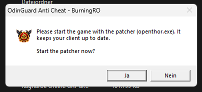
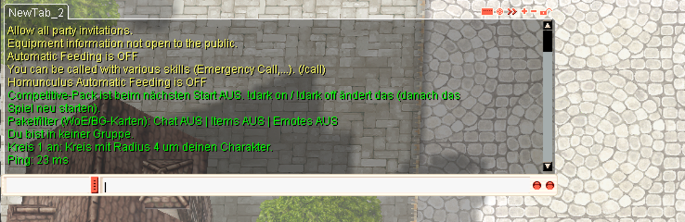
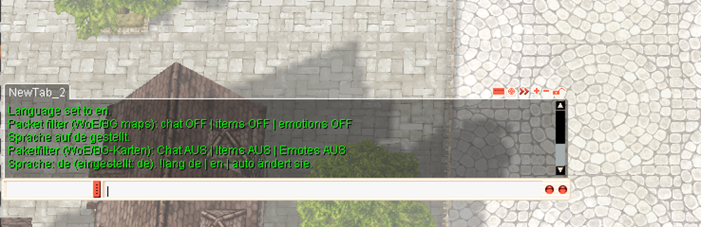
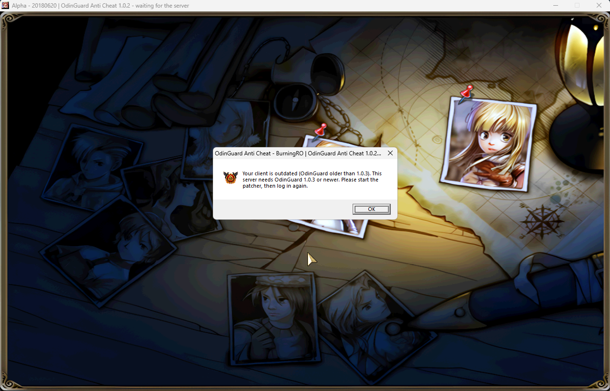

# Integrating OdinGuard Anti Cheat into your server and client

This guide takes a server owner from zero to a protected rAthena server: build a release from a profile, patch
the server, ship the client files, configure the GRF check for your patcher, and roll out in stages without
locking out honest players.

German notes: [03-integration.md](03-integration.md). Architecture: [02-architecture.md](02-architecture.md).

## 0. What you need

| | |
|---|---|
| Server | rAthena (or a fork) with MariaDB/MySQL, C++17 toolchain. Tested: PACKETVER 20180620 **pre-renewal**. The lite ground skills (LGP) and the competitive-pack map lists are pre-renewal only; all other features are not tied to the renewal switch but untested there. |
| Client | Windows client 2010-07-30 or newer that loads `ijl15.dll` (all Ragexe/RagexeRE builds do). Tested: 2018-06-20. |
| Build machine | macOS or Linux with `mingw-w64` (`brew install mingw-w64` / `apt install mingw-w64`), Rust (rustup), optional Node.js for the Studio GUI. Windows works through WSL. |
| Patcher | any patcher that can ship files and DATA.INI changes (Thor, NeonCube, rpatchur, ...). |

## 1. Build the Studio and create a profile

```sh
git clone https://github.com/kxdrsrt/OdinGuard && cd OdinGuard
cd studio && cargo build --release && cd ..
export PATH="$PWD/studio/target/release:$PATH"      # the `og` command

og new myserver.profile.toml --id myserver --operator "My Ragnarok"
```

`og new` writes the profile and three secret files next to it (`keys/server.seed`, `keys/signing.seed`,
`keys/build.secret`). **Back them up and never commit or ship them.** If you lose `server.seed`, every client you
shipped must be replaced; if you change `general.hwid_salt`, every machine ban becomes useless.

The GUI does the same with forms: `cd studio/apps/studio && npm install && npx tauri dev`.

**Downloaded Studio (macOS, Windows, Linux):** every release has a signed Studio build. It builds from the repository's
module list and client sources, so clone or download the repository too; on first start the Studio asks once for that
folder ("Choose folder…") and remembers it. Building the client still needs `mingw-w64` (see above).

## 2. Choose modules, commands and signatures

Open the profile in the Studio (tab *Module & Challenges*) or edit the TOML:

- `modules` – what is built into the DLL and enabled on the server. Unselected modules are not compiled into the
  client (the build checks the linker map). Start with the default set; challenges, `rate-limit`, `behaviour`,
  `ch-captcha`, `ch-honeypot` are opt-in.
- `[params]` – module parameters (`"heartbeat.interval" = 30`, `"multi-client.max_per_machine" = 3`, ...). The
  Studio shows ranges and refuses invalid values (`og validate`).
- `[commands.<id>]` – switch commands off, rename them, change the minimum group or the rate limit.
- `[signatures]` – signature sources and allowlists (`signatures/*.toml`), `max_action` (caps every signature
  action, e.g. `flagban` during the rollout) and per tool group: `[signatures.groups] RCX = "kick"`,
  `GRF = "off"`, `DEBUG = "log"`. `og sig-groups myserver.profile.toml` lists the groups.

Add your own signatures in a separate TOML file (same format as `signatures/signatures.toml`) and list it in
`signatures.sources`. Legitimate tools your players use go to an allowlist file (`[[allow]]`, kinds `file_sha256`,
`grf_sha256`, `path`).

## 3. GRF check (Gepard-style, patcher friendly)

The guard compares every GRF in the client's `DATA.INI` with your list: name, size and a *tail hash* (header +
file table, checked at every scan in milliseconds), and in a background thread the full-file SHA-256.

```sh
og grf-scan myserver.profile.toml --client /path/to/your/clean/client --full
og grf-allow myserver.profile.toml /path/to/dark.grf --note "darkworld"     # optional mods, any name
```

- `grf.file` – accepted versions of your GRFs. Several versions with the same name may be listed.
- `grf.mod` – GRFs players may add (skins, translations, darkworld variants), matched by content, not by name.
- `grf.overlays` – folders where loose files are allowed (e.g. `data\texture\skin\`).
- Actions: `modified_action` (default `kick`), `unknown_action` (`log`), `missing_action` (`log`).
- `odin.grf` and the competitive pack are added by every build automatically.

**Patching workflow** (no false alarms while players update):

1. Build your patch and apply it to a clean client copy.
2. `og grf-scan myserver.profile.toml --client <patched copy> --full --keep-previous` (old and new versions are both
   accepted now).
3. `og build`, deploy the new server config (only `conf/import/odinguard_conf.txt` changes), restart the map-server.
4. Publish the patch through your patcher.
5. After a few days run `og grf-scan` without `--keep-previous` to drop the old versions.

## 4. Optional: competitive pack

An optional GRF (`odin-dark.grf`) that every player gets from you, so everyone plays with the same visuals (dark
floors, flat maps, simplified effects, ... – WoE RO / darkworld style). Pick categories in the Studio tab
*Competitive-Pack* (recipe `assets/competitive/recipe.toml`, staging folders built by
`tools/pack/build_categories.sh`) or point `assets.competitive_pack` to a ready GRF. Its hash enters the GRF
check, so modified or foreign variants are reported.

Per game mode and optionally **required**: pick the map variants `woe`, `bg`, `pvp` one by one
(`tools/pack/split_by_mode.py`), and set `assets.competitive_enforce = ["bg", ...]` so players without the pack are
sent back from those maps (empty = player choice). Check that the pack's maps match the server's map cache with
`tools/pack/verify_mapcache.py`. Everything is in [09-competitive-pack.md](09-competitive-pack.md); the lite ground
skills (`@lgp`, `@square`, `@circle`, `@lgpsound`) are in [08-lgp-guide.md](08-lgp-guide.md).

## 5. Build and verify the release

```sh
og build myserver.profile.toml          # -> output folder of the profile
og verify-release dist/myserver         # signature of manifest.json and every file hash
```

| Folder | Content | Goes to |
|---|---|---|
| `client/` | `odinguard.dll`, `ijl15.dll` (loader), `odin.grf`, `[odin-dark.grf]`, `odinguard.ini`, `README.txt`, licences | your patcher |
| `server/` | module sources, `conf/odinguard_athena.conf`, `conf/import/odinguard_conf.txt`, `conf/odinguard/` (signature package, reference DLL and GRFs), SQL | your rAthena |
| `secrets/odinguard.env` | `ODINGUARD_KEY`, `ODINGUARD_PROTO_SALT`, `ODINGUARD_BUILD_SECRET` | server environment only |
| `patcher/filelist.txt` | file, SHA-256, size | your patcher's file list |
| `docs/` | operator handbook, command reference (de/en), build report | you |

Builds are reproducible: the same profile and sources give byte-identical files. For Control Flow Guard build the
client with llvm-mingw: `OG_TOOLCHAIN=llvm og build ...` (see `client/Makefile`, `LLVM_MINGW`).

## 6. Server (rAthena)

**Quick path (upstream rAthena):** apply `server/patches/rathena-4cd08b7.patch` in your rAthena checkout
(`git apply --check …` then `git apply …`). It contains steps 1–4 below (module files, Monocypher, all hooks, Makefile,
CMake and Visual Studio entries, `conf/odinguard_athena.conf`). Run `./configure` again, rebuild and continue with
step 5. Base commit, conflict resolution on newer rAthena and PACKETVER notes: [`server/patches/README.md`](../server/patches/README.md).

**Manual steps** (forks, or when the patch does not apply):

1. Copy `server/src/common/*`, `server/src/login/*`, `server/src/map/*` into the same folders of rAthena.
   `og_crypto.cpp` compiles Monocypher: copy `third_party/monocypher.c/.h` to `3rdparty/monocypher/`.
2. Add the hook lines listed in [`server/HOOKS.txt`](../server/HOOKS.txt) (socket layer, login, char and map
   server, atcommands, `conf/groups.yml`). [`server/README.md`](../server/README.md) explains each hook.
3. Add `odinguard.o og_crypto.o og_wire.o` to `src/common/Makefile.in` (and the CMake list), add `og_wire.c`,
   `og_wire.h`, `og_proto.h` to the common header dependencies, run `./configure` again and rebuild.
4. Copy `server/conf/*` into `conf/` (keeps your edits out of `odinguard_athena.conf`: the generated
   `conf/import/odinguard_conf.txt` overrides it).
5. Put the three values of `secrets/odinguard.env` into the server environment (Docker/Easypanel/systemd), or as
   `og_key`, `og_proto_salt`, `og_build_secret` lines into `conf/import/odinguard_conf.txt` (keep that file out of
   git then).
6. Start the servers. Tables (`og_client`, `og_component`, `og_ban`, `og_event`, `og_flag`) are created
   automatically; the map-server log shows `OdinGuard Anti Cheat: enabled (...)`.

## 7. Client

1. In the client folder rename the existing `ijl15.dll` (e.g. ROExt's proxy) to `ijl15r.dll`. A plain client has
   Intel's `ijl15.dll`: rename that to `ijl15r.dll` too.
2. Ship `client/ijl15.dll` and `client/odinguard.dll` next to the exe. Load chain:
   `exe → ijl15.dll (OdinGuard loader) → ijl15r.dll (ROExt or Intel) [→ ijl15x.dll]`; the loader also starts the
   guard.
3. Put `odin.grf` (and `odin-dark.grf`) first in `DATA.INI`:
   ```ini
   [Data]
   0=odin.grf
   1=odin-dark.grf
   2=rdata.grf
   3=data.grf
   ```
4. Add every file of `client/` plus `ijl15r.dll` and `DATA.INI` to your patcher's required list.
5. Players never install or uninstall anything themselves; there is no player uninstaller.

### Start only through the patcher (module `launcher`, optional, 1.0.4)

With the module `launcher` the game only runs when the patcher started it, so nobody plays with an old client because
they used a desktop shortcut to the exe. It reads the launch ticket that [OpenThor Patcher](https://github.com/kxdrsrt/OpenThorPatcher)
0.4.0+ writes for every Play (`OPENTHOR_LAUNCH=<token>` in the environment and `_patch/launch-<token>.ticket` in the client
folder, at most 300 s old; protocol in OpenThor's `docs/FORMATS.md`, section 6). The ticket is used once: the guard
deletes it and clears the variable.

Started without a ticket, the guard shows this before the game window opens and closes the game; *Yes* starts the patcher:



```toml
modules = [ …, "launcher" ]
[params]
"launcher.exe" = "openthor.exe"     # the patcher in the client folder
"launcher.message" = "Please start the game with the patcher ({exe}). It keeps your client up to date.\n\nStart the patcher now?"
```

* **Off by default.** Turn it on only when every player has a patcher that writes tickets (OpenThor **0.4.2** or newer,
  or your own patcher with the same protocol); otherwise nobody can start the game. Clients whose exe asks for
  administrator rights (most RO clients) need 0.4.2: Windows drops the variable at the UAC prompt, and 0.4.0/0.4.1 lost it.
* **Not a security boundary.** A player can write a ticket by hand. The module prevents accidental starts without an
  update; the hard rules stay on the server (`og_min_release` refuses old guards, `og_max_windows` limits game windows).
* OdinGuard does not need OpenThor and OpenThor does not need OdinGuard; they share only the documented ticket.

### Install into / remove from a client folder (operator tool)

For your own master and test clients, `tools/client/og_client.py` does steps 1-3 and the way back, with no dependencies
besides Python 3:

```sh
python3 tools/client/og_client.py status    ~/clients/full
python3 tools/client/og_client.py install   ~/clients/full --release myserver/dist/client [--pack [--pack-on]] [--dry-run]
python3 tools/client/og_client.py uninstall ~/clients/full [--keep-settings] [--dry-run]
```

* **Install** keeps the client's own `ijl15.dll` as `ijl15r.dll` (Intel's or ROExt's), copies the loader, `odinguard.dll`,
  `odin.grf` (and `odin-dark.grf` with `--pack`), puts `odin.grf` first in `DATA.INI` (numbered from 0, like the client's
  own `!dark`) and saves the original `DATA.INI` as `DATA.INI.pre-odinguard`. Running it again only updates the files.
  Files are written through a temporary file, so hard-linked client copies are never changed in place.
  The competitive pack is copied **switched off**: players turn it on with `!dark on` (and off with `!dark off`), each
  followed by a restart. `--pack-on` lists it in `DATA.INI` right away; a player's earlier choice survives an update.
* **Uninstall** puts `ijl15r.dll` back as `ijl15.dll`, removes the guard files, `odinguard.ini` (unless
  `--keep-settings`), `odinguard.log` and `odinguard-crash\`, and restores `DATA.INI`: the saved original when the other
  entries are unchanged, otherwise the same list without the OdinGuard entries. It also works on a client that was set up
  by hand (no manifest needed). If `ijl15r.dll` is missing it stops and says what to do; it deletes nothing then.
* It refuses an unclear state (an `ijl15r.dll` next to an `ijl15.dll` that is not the OdinGuard loader).
* Tested: `python3 tests/client/test_og_client.py` (13 cases, uninstall gives back the exact original folder), and on a
  copy of a real 5,545-file client (every non-GRF file identical after install + uninstall) with the game started
  through the loader chain (plain Intel `ijl15.dll`, and the ROExt/dxwrapper client).

On players' machines the patcher does this (the OpenThor patch list's `remove` and `files`); there is still no player
uninstaller. If you let OpenThor Patcher manage `DATA.INI` (`data_ini` in
its patch list), do not run this tool on the same client.

### Languages (1.0.5)

Everything a player reads from OdinGuard comes in the player's language: message boxes (launcher, outdated guard, window
limit, virtual machine, crash reports), the window title, replies to `!dark`, `!vsync`, `!crash`, and the server's chat
messages (`@lgp`, `@circle`, `@pf`, `@spb`, `!ping`, command limits). English and German are built in.

* **Which language:** the Windows display language, or `Language=de` / `Language=en` in `odinguard.ini` (section
  `[OdinGuard]`). The guard sends it to the server in the hello (`og-lang`), so the server answers in it too.
* **Changing it in the game (1.0.6):** `!lang` shows the language, `!lang de`, `!lang en` or `!lang auto` (= Windows)
  changes it at once for the guard's texts, the window title and the server's messages (`@pf`, `@lgp` …), no restart. The
  choice is saved in `odinguard.ini`. Any language with a `[text.<code>]` section in `odinguard.ini` works too. `!lang` is
  an ordinary command (`og_cmd_lang`, group, rate limit, renameable) and is meant to become the one language switch of a
  player when the game itself is translated later (RO client texts, NPC dialogs).
* **More languages or other wording, client side:** in `odinguard.ini` (ship it with your patcher), UTF-8, `{1}` and `{2}`
  are filled in:
  ```ini
  [text.fr]
  dark.usage=Utilisation : !dark on | !dark off
  launcher=Lancez le jeu avec le patcher (openthor.exe).
  ```
  Keys: `client/src/og_lang.c` (table `g_texts`).
* **Server side:** `og_text_<lang>_<key>: <text>` in `conf/import/odinguard_conf.txt` (keys and the German texts:
  `og_texts_de` in `src/common/odinguard.cpp`), and `og_outdated_message_<lang>` for the refusal of an old guard. Guards
  before 1.0.5 report no language and get `og_outdated_message`; write it in both languages if your players need that.
* **Launcher message:** module parameters `launcher.message` (English) and `launcher.message_de` (German).




* **Umlauts:** the 2018 client shows chat in the Windows code page; the server converts its UTF-8 texts to Windows-1252
  (`og_client_charset: cp1252`, default; `utf8` for a client that shows UTF-8). Message boxes are Unicode.

### Updates: how you hear about a new release, and what it does (1.0.7)

* **You are told, nothing is forced.** The Studio asks GitHub once when it starts for the signed version file
  (`releases/latest/download/stable.json`) and shows a banner "OdinGuard X is available" with the release notes
  (*What's new*) and *Later*. Switch the check off under *Updates*; *Check for updates* does it by hand. The request
  carries nothing about you or your server.
* **Installing it changes nothing for players or servers.** The Studio is the guard release: a new Studio builds a new
  guard. Players only get it when you put it into your client and patch it to them; the server only when you deploy
  the build's config. The notes have a *Roll-out* block that says whether the server module or the protocol changed.
* **Order, so nobody is kicked:** install and restart Studio → *Rollout → Keep the built release* (keeps what your
  players have now as an accepted release; the same as `og keep-previous`) → *Build* → deploy the server config (and the
  new server module if the notes say so) → patch the clients → later remove the kept releases or set the oldest release
  that may log in. The *Updates* tab lists these steps.
* Not using the Studio? Watch the repository's releases on GitHub. Maintainers: [RELEASING.md](RELEASING.md).

## 8. Roll out in stages

| Stage | Server | Effect | Move on when |
|---|---|---|---|
| 1 warn | `og_required: no`, `og_log_only: yes` | everything is only logged; flags collect, the ban wave runs dry | `og rollout` shows no unreviewed rule above the false-alarm threshold |
| 2 kick | `og_log_only: no` | actions apply to clients with the guard; players without it still play | false alarms stay low |
| 3 patcher | as 2 | the guard reaches every player | most active accounts log in with the guard |
| 4 required | `og_required: yes` | no login without a valid guard of your build | – |

Flags raised in warn mode never carry the ban mark, so switching to stage 2 does not turn old false alarms into bans
at the next ban wave. Before switching, still look at `@ogflags` and clear false alarms with `@ogflagclear`.

The stage is a profile setting (`[rollout] stage`). Export `og_event` and `og_client` (`mysql -B -e "SELECT ..."`)
and run `og rollout myserver.profile.toml --events og_event.tsv --clients og_client.tsv --advance`, then rebuild
and deploy the server config. The Studio tab *Rollout* does the same.

## 8a. A new release: only the current guard may log in

By default the server lets only the guard release the Studio built log in (`og_min_release`, written by `og build`).
An older guard is refused at the handshake, before the login: the player sees a message box and cannot log in.



> Your client is outdated (OdinGuard 1.0.2). This server needs OdinGuard 1.0.3 or newer. Please start the patcher,
> then log in again.

The text is `og_outdated_message` in `conf/odinguard_athena.conf` (`{have}` = the player's release, `{need}` = the
required one). Nothing is logged as a cheat; the login-server log shows `handshake refused (...)`. Guards before 1.0.3
do not report their release and count as "older than 1.0.3"; they show the message too (the status message box exists
since 1.0.0). `@oginfo` shows the release of a player's guard.

Order: **publish the client files in the patcher first, then deploy the server.** A player who starts the client
before patching gets the message and patches.

Other settings (`[rollout] min_release` in the profile, *Rollout* tab in the Studio):

| `min_release` | Server | Use |
|---|---|---|
| empty (default) | the release the Studio built | strict: everyone has to patch |
| `0` | every release | no release check |
| `1.0.3` | that release and newer | let several recent releases in |

### Soft rollout (optional): keep the previous release for a while

If players should be able to play on with the old client for a few days, the server must also accept the old guard
and the old `odin.grf` (otherwise they are kicked: `guard-code`, failed file challenges, `grf:modified (content)`):

1. Before building the new release, keep the current one: `og keep-previous myserver.profile.toml` (or
   `--from <client dir>` with the files the players have). It copies `odinguard.dll`, `odin.grf` and `odin-dark.grf`
   into `previous-releases/<sha12>/` and adds the folder to `[rollout] previous_releases`.
2. `og build myserver.profile.toml`. While `previous_releases` is set, an empty `min_release` means `0`. The server
   config gets `og_guard_previous_file` (the old guard passes the guard-code check; the code challenge only asks about
   the client exe) and `og_protected_previous` (the file challenge accepts the old GRFs); the old GRFs are listed in the
   GRF manifest after the current ones. The server package carries them in `conf/odinguard/previous/`.
3. Deploy the server, then publish the client files with the patcher.
4. When the old version no longer shows up in `og_client` (or `@oginfo`), remove the entry from `previous_releases`,
   rebuild and deploy the server again: from then on only the current release logs in.

## 9. Day-to-day

- In game: `@oginfo <name>` (guard release, protocol, machine, exe hash), `@ogflags [name]` (open flags), `@ogflagclear
  <name|account id> [rule]` (clear false alarms), `@ogbanwave dry` (who the next ban wave would ban), `@ogban <name>,
  <reason>`, `@ogunban <account id>`, `@oglock <name>[, add|remove|clear|list]` (lock an account to machines).
- Players: `@pf on|off|<c i g>` (alias `@packetfilter`): on WoE and battleground maps, no public chat (c), item use (i)
  or emotions (g) of other players are sent to them (fewer packets in a mass WoE; own packets always arrive);
  `@spb`: support buffs of every party member with the seconds left (the 2018 client has no buff icons in the party
  window, so the list goes to the chat).
- Idle players are not kicked by OdinGuard. `og_alive_timeout` (default 120 s) only disconnects a client whose guard
  stopped reporting (killed or suspended guard); battleground AFK is rAthena's `bg_idle_autokick`.
- New signatures: edit your signature TOML, raise `signatures.version`, rebuild, replace
  `conf/odinguard/odinguard.sigpack`, restart the map-server. No client update needed.
- New OdinGuard version: see 8a (only the new release logs in). Rebuild with the same profile and keys (the Studio warns
  about protocol changes).

## 9a. Web panel (MidgardCP, optional)

The tables `og_client`, `og_component`, `og_ban`, `og_event`, `og_flag`, `og_command`, `og_account_lock` and
`og_crash_token` are the interface for web panels; the
reference copy is `server/sql/odinguard.sql`. A panel such as MidgardCP (planned, `kxdrsrt/MidgardCP`) reads them with a
read-only database user and writes only:

- `INSERT` / `DELETE` on `og_ban` (machine ban / unban; the login-server checks `og_ban` at every login, no restart),
- `UPDATE og_flag SET state = 'cleared'` (false positive),
- `INSERT` into `og_command` (`account_id` or `unique_id`, `command` = `kick` or `message`, `arg`, `issued_by`): the
  map-server that has the player online runs it within `og_command_interval_ms` (default 3 s) and marks it `done`;
  rows nobody takes become `expired` after `og_command_expire_s` (default 600). Only these fixed commands exist, no
  free @commands. Typical use: machine ban in the panel, then `kick` so the ban takes effect immediately.

- `INSERT` / `DELETE` on `og_account_lock` (`account_id`, `unique_id`, `note`): account lock. An account with rows logs
  in only from those machines (login refused with code 3, event `account-lock`); without the guard a locked account
  is refused as well. Let the player confirm by e-mail before you write a row; `og_client` lists the machines an
  account used.
- Crash reports: set the module parameter `crash-report.upload_url` (`og_crash_upload_url`) to your endpoint. After the
  map login the guard gets the URL and a token (row in `og_crash_token`). Reports of the client's `odinguard-crash`
  folder are sent only after the player agreed once (dialog; answer stored in `odinguard.ini`, `[crash] upload`):
  `POST <url>`, body = the text report (max. 512 KB), headers `X-OdinGuard-Token`, `X-OdinGuard-File`,
  `X-OdinGuard-Version`. Accept a report only for a token that exists and is younger than 7 days; set `used`.
- GRF manifest: `og grf-manifest <profile> -o grf-manifest.json` (also `grf-manifest.json` in every release folder):
  the accepted GRF versions (name, size, tail and full SHA-256), hashes only. OpenThor Patcher's Patch Maker writes it
  into the patch site on every publish.

Keep the column names stable; a change to these tables is a breaking change for panels. There is no HTTP API in the
game server.

## 10. Troubleshooting

| Symptom | Cause / fix |
|---|---|
| Map log: `signature package signature INVALID` | package built with another signing key, or edited: rebuild and copy `conf/odinguard/` again |
| Client message "client built for another server" | the DLL was built from another profile (status 3) |
| Everyone gets `grf:modified` after a patch | the new GRF versions were not scanned before the patch – section 3 |
| `grf:unknown` for a skin GRF | allow it with `og grf-allow` or set `grf.unknown_action = "log"` |
| Antivirus warns about `odinguard.dll` | sign the DLLs with your Authenticode certificate; submit the files to the vendor |
| Detection of a legitimate tool | add it to an allowlist file, or set its group to `log` in `signatures.groups` |
